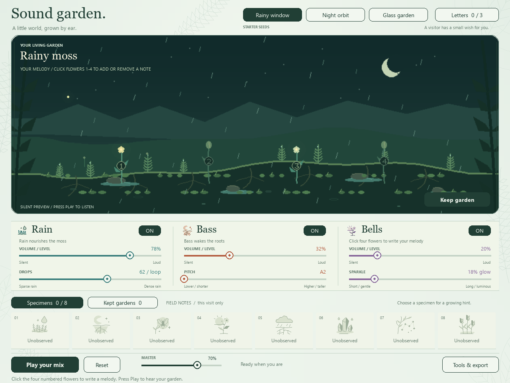
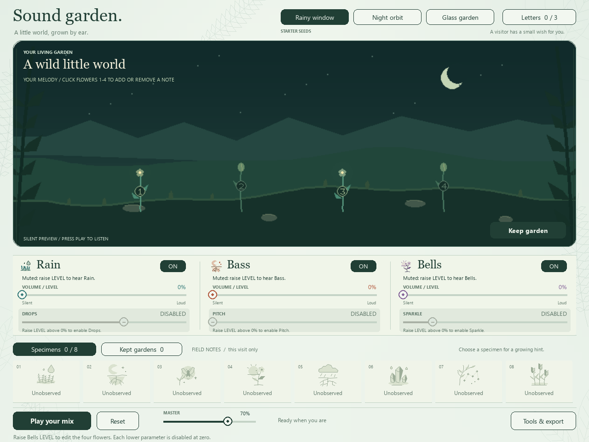

# sound-alchemy-Assignment03

**Grow a little world with sound.**

A small Python experience for someone who wants to play with sound without
learning a music editor. Rain nourishes moss, Bass wakes roots and Bells open
flowers and firefly lights. Click four flowers to write a tiny repeating melody,
discover landscapes, name and keep your favourite gardens, or follow an optional
visitor invitation. No music theory is needed.



The interface is a night greenhouse and a botanical field notebook. A large
living garden occupies the main stage; a single sound workbench sits below it.
Eight ink-and-wash specimens have their own silhouettes, visitor letters open
only when wanted, and saved gardens carry pictures of their actual recipes.
All illustrations are drawn from Python/Pygame geometry without external assets.

[See the eight specimens](docs/field-notes.png),
[kept recipe pictures](docs/kept-gardens.png), or
[watch a specimen being filed](docs/discovery-unlock.gif).
The silent GIF is a scripted demonstration using the actual app renderer,
not a recording of a user trial.

[Watch the four-flower melody](docs/flower-melody.gif) and
[hear an example](docs/flower-melody.wav). The GIF is silent; the separate WAV
demonstrates a prepared recipe. These are scripted examples, not a user trial.

## The interaction

1. Move a slider and watch the garden respond immediately. Press **Play your mix**
   when you want to hear it. A stopped speaker still allows a visual preview.
2. Click the four numbered flowers to make each one ring or rest. Flowers 1-4
   occupy seconds 0, 1, 2 and 3 of the repeating four-second loop. Flowers 1 and 3
   start lit. During playback a firefly visits the beats and each sounding flower
   lights up. Try leaving one quiet beat, then adding it back.
3. Explore eight landscape discoveries, shown together in **Specimens**. Click an
   unobserved silhouette for a clear recipe hint. A new discovery shows its name,
   a short garden celebration and a leaf flying into the notebook. Its specimen
   gains colour and a NEW marker. Use **View specimen** to find it;
   there is no gameplay timer, score or wilting penalty.
4. Choose **Keep garden**, give it a name and press Enter. In **Kept gardens**,
   click a card to restore its sound controls, four-flower melody and landscape,
   then press Play. Its thumbnail comes from that saved recipe.
5. For a little direction, click **Letters**, then **Open invitation** on a visitor
   letter. Its hint gives generous ranges. **Share this garden** checks them and
   awards a thank-you stamp. **Next note** lets you try another; the x closes the
   letter so you can see the whole garden again. Free exploration always works.
6. **Reset** restores the initial sound controls and the starter melody, and stops playback. It preserves
   this visit's discoveries, cards and stamps. Closing and reopening starts a
   fresh visit with no progress. Under **Tools & export**, **Save 8-second WAV**
   exports sound and a recipe; **Open exports** opens the folder.

The short loop is **adjust or click a flower > see/hear > try another phrase > keep**.
The three optional wishes provide gentle goals. They accept multiple recipes;
there is no exact sound-matching test. The garden responds directly to control
state, rather than analysing speaker output. Lowering MASTER leaves it intact.

All sounds and graphics are generated locally. Nothing plays on startup, and
switching windows stops playback. No accounts, microphone or services are needed.

## Run on Windows

You need [uv](https://docs.astral.sh/uv/getting-started/installation/) on your PATH.
On the development computer it is already available. The first setup needs
internet; subsequent launches work offline once the local runtime and package
are cached.

**Double-click `start.cmd`.** It finds or prepares Python 3.12 inside this folder,
installs the declared Pygame dependency into the project cache, then opens the
app. It does not install global Python commands or edit the Windows registry.
Keep the launcher terminal open while using the app. Close the app window to exit.

The same setup can be reproduced from a fresh PowerShell terminal in this folder:

```powershell
$env:UV_CACHE_DIR = "$PWD\.uv-cache"
$env:UV_PYTHON_INSTALL_DIR = "$PWD\.python"
$env:PYTHONDONTWRITEBYTECODE = "1"
uv python install 3.12 --no-bin --no-registry
uv run --no-project --managed-python --python 3.12 app.py
```

`app.py` declares `pygame==2.6.1` in its `# /// script` header. No global pip
installation, manual virtual-environment activation or course Week 4 environment
is needed. Python 3.12.14 and Pygame 2.6.1 were used for local verification.

If you already have a suitable Python and prefer your normal uv setup:

```text
uv run --no-project --python 3.12 app.py
```

This shorter command uses your normal uv cache/settings. The Windows launcher
and full PowerShell instructions above keep the runtime and cache in this project.

For macOS/Linux with uv and Python 3.12:

```bash
UV_CACHE_DIR="$PWD/.uv-cache" uv run --no-project --python 3.12 app.py
```

Only Windows has been checked. On other systems Pygame's bundled font replaces
the Windows fonts; the appearance may differ.

## Controls and feedback

The four newer discoveries add distinct scenery:

| Discovery | Landscape response |
| --- | --- |
| Storm roots | A dark rain cloud and glowing underground roots. |
| Crystal rain | Blue faceted crystals beside reflective rain pools. |
| Starlit canopy | An arch of leaves and linked constellations above the garden. |
| Amber reeds | Tall golden reeds under a warm horizon. |

All eight specimens are visible on one notebook shelf. Unobserved entries keep
their distinctive pale silhouettes; observed entries gain their own muted colour.
Unlocks work during silent visual preview as well as playback. A named notice,
a garden celebration, a 1.35-second filing animation and the specimen highlight
make the result visible. An already discovered recipe does not repeat the reward.

| Action | Response and feedback |
| --- | --- |
| Click a preset | Loads a different combination while preserving the four flower choices; the selected button is highlighted. |
| Click an ingredient's ON/OFF button | Adds/removes that ingredient; the card and label change. |
| Drag LEVEL | Changes the running sound volume and the corresponding rain, roots or flowers. The phrase keeps its position. |
| Click flower 1 / 2 / 3 / 4 | Toggles the bell at second 0 / 1 / 2 / 3. A lit flower rings; an unlit one rests. Flower numbers, light and the travelling firefly connect the edit to its place in the loop. Rain and Bass continue uninterrupted. |
| Drag DROPS | Changes the density of overlapping soft rain textures; Rain remains a continuous curtain rather than separate audible taps. |
| Drag PITCH | Changes Bass pitch and plant height; the four bell notes follow the Bass root using notes from a pentatonic scale. |
| Drag SPARKLE | Changes bell decay and flower glow. The four beat positions and chosen flowers stay unchanged. |
| LEVEL at zero / ingredient OFF | Its lower parameter is greyed out and marked DISABLED. Clicks and drags are blocked; the hint explains how to enable it. Its previous value is preserved. |
| Bells LEVEL zero / OFF, then click a flower | The melody is preserved and the click explains how to re-enable Bells. MASTER at zero still allows composing; raise it to hear the result. |
| Drag MASTER | Changes all running layers immediately, including the recipe used for export. |
| Play your mix / Stop listening / Space | The single main button starts or stops playback; repeated presses do not stack copies. Stopping keeps the recipe. |
| Escape | Closes the letter/tools and stops immediately; later background work cannot restart it. In the naming dialog it cancels naming. |
| Reset / R | Stops and restores the initial Rainy window controls and flowers 1+3; keeps discoveries and saved cards. |
| Tools & export / Save / S | Opens the export controls; Save or S writes a new 8-second WAV and recipe under `out/mixes/`. |
| Open exports | Becomes available after a successful WAV save and opens the export folder. |
| Keep garden | Names and keeps a complete recipe for this visit, including all switches, MASTER and the four flower steps. Enter confirms; Esc or Back cancels. Closing clears it. |
| Specimens / Kept gardens | Shows all eight illustrated discoveries, or restorable cards with actual recipe thumbnails. Kept gardens have arrows when more than four are stored. |
| New discovery / View specimen | Shows the unlocked name and a short celebration, then sends a leaf into the notebook. View specimen selects that shelf. The x dismisses the notice. Rapid discoveries queue in order, and naming a garden pauses the notice timer. |
| Letters / Open invitation / Share this garden | Opens an optional letter, accepts its wish, then checks broad conditions. A mismatch pulses the letter border and shows NOT QUITE YET with a specific unmet LEVEL or ON/OFF requirement. Close the letter with its x or the Letters button. |
| Next note | Leaves the current invitation without a penalty; keeps previous stamps. |
| Switch to another window | Stops playback; press Play after returning. |

The living garden maps ingredient controls to procedural geometry. During
playback, each bell onset lights its assigned flower with the note's attack and
decay; the one-second bass pulse moves light through the roots. The audio and
these gestures share `bell_pattern()` and `bass_pulse()` and use the playback
clock, including the newly accepted pattern after an update. This is scheduled
visual feedback, not analysis of the speaker output. Stopping or muting the
relevant sound removes its sound-led gestures; the garden can still be previewed.
Levels, MASTER and individual ON/OFF switches rebalance existing running layers,
preserving the phrase position. Making everything silent stops playback.
Clicking a flower regenerates only the Bells layer. The replacement bell buffer
is rotated to the current loop position, preserving the playback origin and
letting Rain and Bass continue. The flower edit is visible immediately; its
sound starts when the updated buffer is ready. Changing DROPS, PITCH, SPARKLE
or a preset prepares a new pattern (`UPDATING`),
usually in under a second on the development computer, then restarts the
four-second phrase with a short transition. Rapid mouse moves are combined so
the interface follows the latest slider position.

## Mistakes and interruptions

An unsuitable shared recipe shows an orange **NOT QUITE YET** panel beside the
Share button, the number of unmet conditions, and one concrete adjustment to
try next. The border pulses briefly on every rejected click. The explanation
stays after the pulse and clears when controls change or another note opens.
Sharing again checks the latest recipe. Completed notes retain their stamp and
cannot be rejected by a rapid second click. No error sound is played.

[Preview the wrong-recipe feedback](docs/wish-feedback.gif) (scripted capture).

The upper **VOLUME / LEVEL** slider controls whether an ingredient can be heard.
DROPS, PITCH and SPARKLE modify that ingredient; they are not separate sound
sources. At LEVEL zero, raise that upper slider to enable the lower control.
If the ingredient is OFF, switch it on as well. MASTER and playback remain
independent: stopping playback still allows editing an enabled ingredient.



- **Everything is off / all levels are zero:** Play explains how to make the
  mix audible. Saving a silent recipe gives a message rather than a misleading file.
- **All four flowers rest:** Bells is silent even with a positive LEVEL. Click
  one flower to bring a note back. Discovery and visitor checks treat the absent
  Bells as zero, and their feedback can ask for a lit flower. Rain or Bass may
  still play and be kept. A Bells-only garden with four resting flowers cannot
  be kept or exported as a misleading silent result.
- **No audio device:** the interface and WAV export remain available. Check the
  selected output device and press Play again to retry the connection.
- **Repeated clicks:** Play toggles one playback state. Save has a short cooldown;
  each completed export gets a unique name and never replaces an earlier export.
- **Stop while the sound is updating:** playback remains stopped after the update.
- **Folder cannot be written:** a save error appears; the app remains usable.
- **Export folder cannot be opened:** the saved files remain intact and a
  message explains their location. If the saved file was moved, save again.

If you hear nothing, check the ON/OFF buttons, levels, lit flowers, MASTER and device volume.
If setup cannot download a dependency, keep the launcher message and retry when
the connection is available. No service credentials are needed.

## A fresh visit each time

Every launch starts with **0/8 discoveries, 0/3 visitor stamps and no kept
gardens**. Current recipe controls return to their initial values, with flowers
1 and 3 lit. Progress and
cards live only in memory for this window, so the next visitor starts fresh.
Within one visit you can still name, keep, page through and restore garden cards.
The Reset button resets sound controls while retaining that visit's progress;
close and reopen the app for a completely fresh visit.

The app does not read or write progress files during normal use. Older
`out/gardens/` snapshots are left intact and are ignored on startup. Explicitly
exported WAVs and their recipe files under `out/mixes/` remain on disk; use
**Save 8-second WAV** before leaving if you want to keep an audio result.

Names can contain 1-28 characters, including Chinese on Windows. Empty names
receive an inline message. A completely empty garden cannot be kept; muting
MASTER is allowed because it only controls listening volume. The naming dialog
and collection area explain that kept cards last until the window closes.
New recipes include a four-boolean `flower_steps` field; a malformed field is
rejected. Existing explicit archives without that field use the starter melody
when read. Normal startup still ignores those archives.

## Files

```text
app.py            window, naming, visitor/collection controls and audio playback
backdrop.py       cached mist gradient, botanical line art and soundwave rings
garden.py         discoveries, wishes and validated cards for the current visit
garden_view.py    landscape plus flower/root gestures from the shared sound timing
specimens.py      eight ink-and-wash studies and the leaf-filing animation
sound.py          Mix state, shared note timing, synthesis and WAV/recipe export
start.cmd         Windows launcher with a project-local runtime/cache
test_sound.py     signal and export checks; Python standard library only
test_ui.py        event-handler checks using silent SDL test devices
test_garden.py    fresh visits, discovery, wish, card and legacy archive checks
test_rhythm.py    shared note onsets, flower envelopes and muted rhythm gestures
test_melody.py    four-beat audio, Sparkle independence and cached layer checks
test_flower_view.py four-flower geometry, beat lights and muted-preview checks
README.md         idea, controls, run instructions and limitations
PROCESS.md        development decisions, AI use and real user-trial status
CREDITS.md        course inspiration and software/font credits
docs/             interface screenshot, verification notes and sample sound
out/              local exports/check outputs; excluded from version control
```

`.uv-cache/`, `.python/`, `.backups/` and generated `out/` files are ignored.
The screenshot and intentionally prepared demonstration WAV under `docs/` are
shareable project materials. No borrowed recordings are required.

## Check it

After the PowerShell setup above:

```powershell
uv run --no-project --managed-python --python 3.12 test_sound.py
uv run --no-project --managed-python --python 3.12 test_ui.py
uv run --no-project --managed-python --python 3.12 test_garden.py
uv run --no-project --managed-python --python 3.12 test_rhythm.py
uv run --no-project --managed-python --python 3.12 test_melody.py
uv run --no-project --managed-python --python 3.12 test_flower_view.py
```

The sound checks compare real sample changes, pitch, silence, headroom,
repeatability and exported bytes. UI checks exercise the real handlers with
silent test devices; they do not prove speaker output or replace a human trial.
Check outputs remain under `out/`.

See [verification notes](docs/VERIFICATION.md) for the checks actually performed.
An [8-second four-flower example](docs/flower-melody.wav) and a
[rain-only preview](docs/rain-only-v4.wav) are available when someone
cannot run the app. They illustrate the sound; the screenshot and controls table
explain the interaction. The [unlock demonstration](docs/discovery-unlock.gif)
shows a named specimen being filed into the notebook; the
[rejected-share demonstration](docs/wish-feedback.gif) shows a visitor's specific
adjustment feedback. Both are silent scripted captures of the current interface.
A sound-enabled screencast and live website have not been produced.

## What one piece of the code does

In `Lab.move_slider()` a user's drag changes `mix.levels[index]`. `changed()`
updates the volumes of the existing Sound objects, so the phrase keeps moving.
`draw_garden()` uses that same Mix to change rain, moss, root movement and flowers;
`Garden.discover()` checks whether a new landscape has appeared. Naming a card
saves the recipe; restoring it supplies a new Mix without changing the saved one.
`mix_layers()` combines the cached ingredients with that same recipe for the
exported WAV. Character controls ask the worker to make new ingredients;
volume-only changes reuse them. `bell_pattern()` supplies the exact note start
samples to both synthesis and flower-light envelopes; `bass_pulse()` supplies
the same strength cycle to sound and roots. This is the connection between
**input, program response and feedback**.

For the new direct interaction, `Lab.toggle_flower()` changes one boolean in
`mix.flower_steps`. `bell_pattern()` translates enabled steps into sample onsets
at 0, 1, 2 and 3 seconds; both the bell generator and flower lights read those
onsets. A cached Rain/Bass pair is reused, and the new bell buffer joins at the
current phrase position. Kept cards and exported JSON copy all four booleans,
so restoring a card or exporting audio uses the same composition.

## Limits and submission status

This is a deliberately small sound garden: eight landscape discoveries and three
visitor notes. It is not an endless simulation. The value comes from exploring
and keeping different sound/visual combinations. Current
Rain uses filters fitted to the measured spectrum of the student's
[Minecraft rain reference](https://www.bilibili.com/video/BV1Pe411x7JY/), with
seeded noise and short strength changes. The
[measurement summary](docs/rain-reference-profile.json) records the reference
window and fitted coefficients. NumPy was used only for local analysis; the app
keeps its existing Python/Pygame setup. No reference audio is needed to run it.

The tonal impact/resonance grains in v2 were removed after listening feedback;
the student also rejected v3 and supplied this concrete reference. The
[first-version scene](docs/rainy-window.wav) and
[v2](docs/rain-only-v2.wav) / [v3](docs/rain-only-v3.wav) rain samples are kept
as iteration references. New recipes identify the current rain model as
`minecraft-reference-v4`. The Bilibili recording is used for local analysis and
is not redistributed; exported WAVs are newly synthesized.
Patterns are fixed four-second loops with four editable bell beats; users toggle
notes rather than placing them freely or selecting their pitches. Recipes
can be restored through kept garden cards. Arbitrary exported JSON files cannot
yet be imported through the interface. Slider controls need a pointer. Headroom
prevents digital sample clipping; it cannot determine an appropriate device volume.
Live playback uses Pygame's 16-bit mixer and quantized gain controls; the exported
WAV is mixed from the same source layers and exact recipe values, so tiny rounding
differences from live output are possible. Neither the garden animation nor the
export is a recording of the microphone or speakers.

**A real user trial and the student's personal review of the AI-assisted work
are still pending.** Before submission, check that this revision is in the
student's public repository, verify the link while signed out, and submit it on
Canvas. Automatic checks are not another person's trial. See `PROCESS.md`,
`CREDITS.md` and the dated verification record for what has actually been checked.

